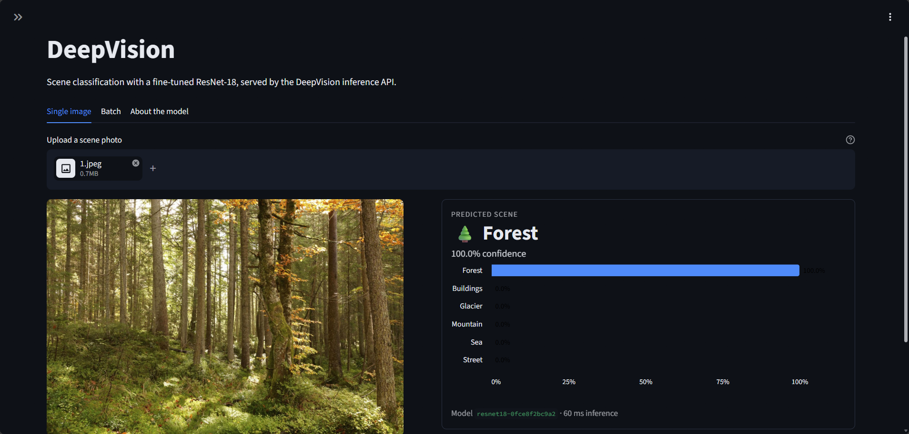
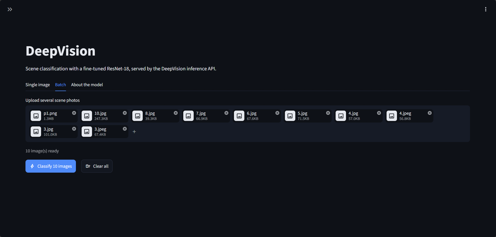
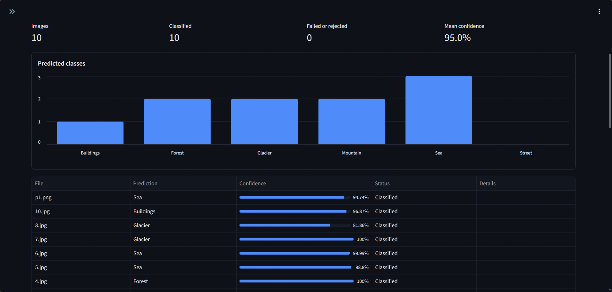
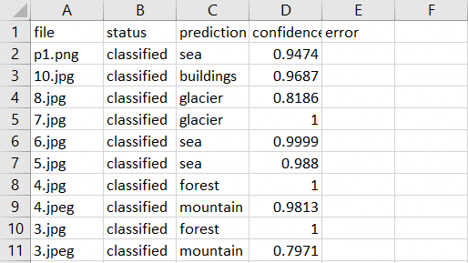
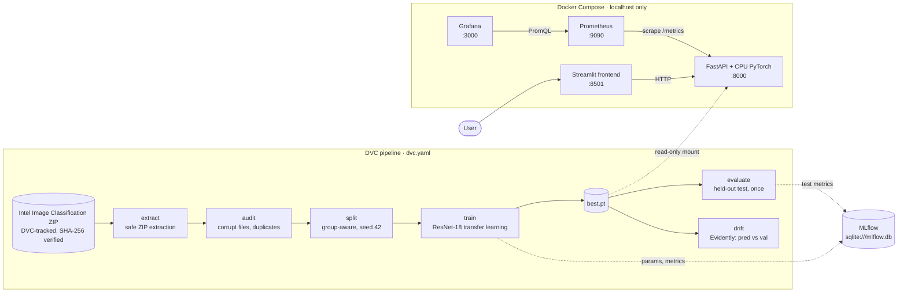

# DeepVision

DeepVision is an end-to-end computer vision and MLOps portfolio project: a six-class
scene classifier built with PyTorch transfer learning, wrapped in the tooling needed to
train, track, serve, and monitor it.

A ResNet-18 fine-tuned on the [Intel Image Classification](#dataset) dataset reaches a
**macro-F1 of 0.940** (95% CI 0.932–0.948) on a held-out test set that was never used for
training or model selection. The model is served by a local FastAPI service with a
Streamlit frontend, packaged in Docker, monitored with Prometheus and Grafana, and checked
for data drift with Evidently.

> **Status:** the data pipeline, training, held-out evaluation, a local FastAPI
> inference service with a Streamlit frontend, their Docker images, GitHub Actions CI,
> Prometheus/Grafana monitoring, and Evidently data drift analysis are implemented.

## Features

- **Reproducible data pipeline.** DVC stages `extract → audit → split → train → evaluate`,
  plus `drift`. The dataset archive is verified against a SHA-256 checksum and every ZIP
  entry is validated before extraction.
- **Data audit and leakage control.** Corrupt files, exact duplicates, and near-duplicates
  (dHash + pHash) are detected. Duplicate groups never span train/validation or
  training/test, and images with conflicting labels are excluded.
- **Transfer learning.** Two-phase fine-tuning (classifier head, then the full network),
  mixed precision, and early stopping on validation macro-F1, with runs tracked in MLflow.
- **Honest evaluation.** One held-out test evaluation with 95% bootstrap confidence
  intervals, on a clean test set and on the official one for comparison
  ([evaluation policy](docs/evaluation.md)).
- **Inference API.** FastAPI service with single and batch prediction, health and
  readiness probes, a model card endpoint, and Prometheus metrics ([docs/api.md](docs/api.md)).
- **Web frontend.** Streamlit client for single images and batches, with CSV export; it
  never loads the model itself ([docs/frontend.md](docs/frontend.md)).
- **Containers.** Hardened, CPU-only Docker images and a Compose stack bound to localhost
  ([Docker](#docker)).
- **Monitoring.** Prometheus scraping, four unit-tested alert rules, and a provisioned
  Grafana dashboard ([Monitoring](#monitoring)).
- **Drift detection.** Evidently compares input statistics and model outputs, with
  simulated drift demonstrations and a CI-friendly exit code ([docs/drift.md](docs/drift.md)).
- **CI.** GitHub Actions runs Ruff, pytest, Docker build and smoke tests, and the
  Prometheus rule tests on every push and pull request.

## Screenshots

**Main interface: single-image classification.** Upload a photo to get the predicted
scene, its confidence, and the probabilities of all six classes.



**Batch classification.** Upload many images at once, then review a summary, the
predicted-class distribution, and per-image results.

| Batch upload | Batch results |
|---|---|
|  |  |

**Exported results.** Batch results can be downloaded as CSV (shown here opened in Excel).



## Architecture



| Concern | Tool |
|---|---|
| Model training | PyTorch + torchvision (pretrained backbone, transfer learning) |
| Experiment tracking | MLflow |
| Data and pipeline versioning | DVC |
| Inference API | FastAPI + Uvicorn |
| Web frontend | Streamlit (a client of the API; no model in the frontend) |
| Containerization | Docker |
| CI/CD | GitHub Actions |
| Testing | pytest |
| Operational monitoring | Prometheus + Grafana |
| Data quality and drift | Evidently |

## Dataset

DeepVision uses [Intel Image Classification](https://www.kaggle.com/datasets/puneet6060/intel-image-classification),
published on Kaggle by Puneet Bansal. The images were originally released by Intel for a
scene classification challenge on Analytics Vidhya. The dataset has 24,335 natural-scene
photos (150×150 JPEG) in six classes: `buildings`, `forest`, `glacier`, `mountain`, `sea`,
and `street`.

| Archive folder | Images | Used as |
|---|---:|---|
| `seg_train` | 14,034 | Training (11,882) and validation (2,098); 54 images excluded for label conflicts or links to test images |
| `seg_test` | 3,000 | Held-out test: all 3,000 (official), or 2,997 without 3 label conflicts (clean, primary) |
| `seg_pred` | 7,301 | Unlabelled; the stand-in for live traffic in drift analysis |

The counts come from `reports/audit/summary.json` and `reports/splits/summary.json`.

**License.** Kaggle lists the dataset's license as *"Data files © Original Authors"*: no
open license is granted. The images are therefore **not included** in this repository, its
DVC cache, or its Docker images. Download them yourself under Kaggle's terms and do not
redistribute them.

**Download.** Download the dataset from its Kaggle page (a Kaggle account is required)
and place the archive at `data/raw/intel-image-classification.zip`, the path the
pipeline reads (`configs/data.yaml`).

The pipeline accepts exactly one archive. The `extract` stage checks the file against the
SHA-256 recorded in `configs/data.yaml` and stops with `SHA-256 mismatch` if it differs.
To check the file before running the pipeline:

```powershell
Get-FileHash data\raw\intel-image-classification.zip -Algorithm SHA256
# expected: 3921405607C3E9D67A3459B6C629894C3A723AA1647F9310B6793DA306E89337
```

> **Unverified:** the repository does not record how the original archive was downloaded,
> and it has not been checked whether a download from Kaggle today produces a file with
> this checksum. If yours does not match, the pipeline will not run on it unchanged.

## Repository layout

```
configs/              Data, training, evaluation, and drift settings (used by dvc.yaml)
data/                 Local datasets; only DVC metadata (raw/*.dvc) is committed to Git
src/deepvision/       Python package; each pipeline stage is a module run with `python -m`
  data/               Archive extraction, audit, split, dataset, and transforms
  models/             Backbone factory
  training/           Training loop and configuration
  evaluation/         Held-out evaluation, metrics, and checkpoint loading
  inference/          Predictor shared by the API and the drift analysis
  monitoring/         Evidently drift analysis
  api/                FastAPI service
  frontend/           Streamlit client
tests/unit/           pytest suite (some tests are marked `integration`)
reports/              Audit, split, training, evaluation, and drift reports tracked in Git
artifacts/            Training outputs; artifacts/checkpoints/best.pt is a DVC output, not in Git
monitoring/           Prometheus configuration and alert rules (with tests), Grafana provisioning
docs/                 API, evaluation, drift, and frontend documentation; screenshots
dvc.yaml, dvc.lock    Pipeline definition and the recorded state of each stage
Dockerfile            CPU inference image (compose.yaml runs it)
frontend.Dockerfile   Streamlit frontend image (no model inside)
compose.yaml          API, frontend, Prometheus, and Grafana services
.streamlit/           Streamlit settings: theme, telemetry off, upload limit
.github/workflows/    CI pipeline
```

## Installation

Requires Python 3.12. PyTorch is installed separately so the build matches your hardware
(this project is developed against `torch 2.5.1+cu121` on a 2 GB GPU):

```powershell
python -m venv .venv
.\.venv\Scripts\Activate.ps1
# NVIDIA GPU (CUDA 12.1):
pip install torch==2.5.1 torchvision==0.20.1 --index-url https://download.pytorch.org/whl/cu121
# or CPU only (the build used by CI and the Docker image):
# pip install torch==2.5.1 torchvision==0.20.1 --index-url https://download.pytorch.org/whl/cpu
pip install -r requirements-dev.txt
pip install -e . --no-deps
```

`requirements-dev.txt` includes the pipeline, serving, and frontend dependencies plus the
test and lint tools. `--no-deps` stops pip from replacing the PyTorch build you chose.

## Pipeline

Place the dataset ZIP in `data/raw/` (see [Dataset](#dataset)), then run the DVC pipeline
(`dvc.yaml`): `extract → audit → split → train → evaluate`, plus `drift` after `train`.

```powershell
dvc repro            # reruns only stages whose inputs changed
dvc metrics show     # audit, split, training, evaluation, and drift metrics
```

- **No DVC remote is configured.** Outputs live in the local DVC cache of the machine that
  produced them, so `dvc pull` is not available. On a fresh clone, `dvc repro` rebuilds
  everything from the ZIP. On a machine whose cache already holds the outputs,
  `dvc checkout` restores them without rerunning anything.
- **Training** downloads ImageNet weights on first use (about 45 MB for ResNet-18). The
  recorded run took about 49 minutes on a 2 GB GeForce MX450 (`reports/training/metrics.json`).
  It also runs on CPU, more slowly.
- **Experiment tracking.** Runs are logged to `mlflow.db` in the repository root. To browse
  them, run `mlflow ui --backend-store-uri sqlite:///mlflow.db` and open `http://127.0.0.1:5000`.

See `docs/evaluation.md` for the held-out test policy.

## Results (ResNet-18 baseline)

| Split | Images | Macro-F1 | Accuracy |
|---|---:|---:|---:|
| Validation (model selection) | 2,098 | 0.949 | 0.949 |
| Clean test (primary) | 2,997 | 0.940 [95% CI 0.932–0.948] | 0.939 |
| Official test | 3,000 | 0.940 | 0.939 |

The clean test set is the original `seg_test` folder minus 3 images with conflicting
labels. The checkpoint was selected on validation macro-F1, and the test sets were
evaluated once afterwards. The main remaining confusions are mountain ↔ glacier and
street ↔ buildings. Full metrics are in `reports/evaluation/metrics.json`.

## Data drift

`dvc repro --single-item drift` uses Evidently to compare the dataset's 7,301 unlabelled
`pred` images (the stand-in for live traffic) with the validation images. It never reads
the held-out test set. `--single-item` runs only this stage, never retraining. Each image
is described by 10 input statistics (brightness, contrast, colour, saturation, sharpness,
entropy, size) and 9 model outputs (predicted class, confidence, prediction entropy, class
probabilities). Input drift and prediction drift are judged separately.

| Run | Input drift | Prediction drift | Verdict |
|---|---|---|---|
| `pred` vs `val` (real) | 0/10 columns | 0/9 columns | No drift |
| Simulated darkening | 7/10 | 0/9 | Drift |
| Simulated blur | 4/10 | 7/9 | Drift |

The results are in `reports/drift/summary.json`, with an interactive report in
`reports/drift/report.html`. To reproduce the demonstrations, run
`python -m deepvision.monitoring.drift --simulate darken --output-dir tmp\drift-darken`
(or `--simulate blur`); `--output-dir` is required with `--simulate`, so the real results
are never overwritten. `--fail-on-drift` exits with code 3 for automation. See
`docs/drift.md` for features, method, and limitations.

## Serving

A local FastAPI service serves the trained checkpoint (`artifacts/checkpoints/best.pt`)
on CPU by default:

```powershell
uvicorn deepvision.api.app:create_app --factory --host 127.0.0.1 --port 8000 --workers 1
curl.exe -F "file=@image.jpg" http://127.0.0.1:8000/predict
```

Interactive documentation is at `http://127.0.0.1:8000/docs`. See `docs/api.md` for
configuration, endpoints, errors, and limitations. The service has no authentication and
binds to localhost only; do not expose it publicly without adding protections.

## Docker

The image runs the same service on **CPU-only PyTorch** (`torch 2.5.1+cpu`, same version as
development) as a non-root user. It contains the code and serving dependencies only:
**the checkpoint is not baked in**. Compose bind-mounts `artifacts/checkpoints/best.pt`
and `reports/evaluation/metrics.json` read-only, so a retrained model needs a container
restart, not a rebuild.

Requires Docker Desktop (WSL 2 backend) and the checkpoint on disk. Commands are for
Windows PowerShell, run from the repository root:

```powershell
# 1. The checkpoint must exist as a file: produce it with `dvc repro`, or restore it with
#    `dvc checkout` on the machine whose DVC cache holds it (no DVC remote is configured)
Test-Path artifacts\checkpoints\best.pt -PathType Leaf   # must print True

# 2. Build and start (first build downloads ~200 MB of CPU PyTorch wheels).
#    This also starts the Streamlit frontend (see Frontend) and Prometheus and Grafana
#    (see Monitoring); for the API alone use `docker compose up --build -d api`.
docker compose up --build -d
docker compose ps            # wait for STATUS "(healthy)": the model is loaded
docker compose logs -f api   # Ctrl+C stops following, not the container

# 3. Use it
Invoke-RestMethod http://127.0.0.1:8000/health
Invoke-RestMethod http://127.0.0.1:8000/ready
Invoke-RestMethod http://127.0.0.1:8000/model
curl.exe -F "file=@image.jpg" http://127.0.0.1:8000/predict
curl.exe -F "files=@a.jpg" -F "files=@b.png" http://127.0.0.1:8000/predict/batch
curl.exe http://127.0.0.1:8000/metrics

# 4. Stop and remove the container
docker compose down
```

Use `curl.exe` (not the `curl` alias) for uploads: Windows PowerShell 5.1's
`Invoke-RestMethod` cannot send multipart forms.

**Configuration.** Set variables in the shell (or in a `.env` file, which Git ignores)
before `docker compose up`:

```powershell
$env:DEEPVISION_PORT = "8080"          # host port (default 8000; always bound to 127.0.0.1)
$env:DEEPVISION_NUM_THREADS = "4"      # CPU threads per forward pass (default: PyTorch's)
$env:DEEPVISION_MAX_BATCH = "16"       # see docs/api.md for the variables
$env:DEEPVISION_MAX_UPLOAD_MB = "10"
docker compose up -d
```

**Without Compose**, the equivalent `docker run`:

```powershell
docker build -t deepvision-api:latest .
docker run -d --name deepvision-api -p 127.0.0.1:8000:8000 `
  --read-only --tmpfs /tmp:size=64m,noexec,nosuid,nodev `
  --cap-drop ALL --security-opt no-new-privileges --init --memory 2g --pids-limit 256 `
  --mount "type=bind,src=$PWD\artifacts\checkpoints\best.pt,dst=/app/artifacts/checkpoints/best.pt,readonly" `
  --mount "type=bind,src=$PWD\reports\evaluation\metrics.json,dst=/app/reports/evaluation/metrics.json,readonly" `
  deepvision-api:latest
```

With `--read-only`, the `--tmpfs /tmp` is required: PyTorch needs a writable temporary
directory at import.

**Health.** The image's `HEALTHCHECK` polls `/ready`, so the container turns *healthy*
once the model is loaded (about 5 s) and *unhealthy* if it cannot be loaded. `/health`
remains a pure liveness probe. A missing or invalid checkpoint does not crash the
container: `/health` returns 200 and the other endpoints return 503 (see `docs/api.md`).

**Security settings** (in `compose.yaml`): port published on `127.0.0.1` only; non-root
user (UID 10001); read-only root filesystem with a small `noexec` tmpfs at `/tmp`; read-only
model mounts; all Linux capabilities dropped; `no-new-privileges`; memory (2 GB), PID, and
log-size limits; one Uvicorn worker. The build context is an allow-list
(`.dockerignore`), so data, checkpoints, MLflow runs, `.git`, and `.venv` never enter the
image. The API still has no authentication or TLS: keep it on localhost.

**Troubleshooting.** If the container is *unhealthy*, run `docker compose logs api`; the
line `model not ready: not_found` means the checkpoint was missing. Docker Desktop
creates a missing bind-mount source as an **empty directory**, so if `best.pt` was absent
at `docker compose up`, check for an empty `artifacts\checkpoints\best.pt` directory and
remove it before restoring the file with `dvc checkout` (or `dvc repro`).

## Frontend

A dark-themed Streamlit interface at `http://127.0.0.1:8501`, started by
`docker compose up --build -d`. It has three tabs:

- **Single image:** a preview, the predicted scene and confidence, and a chart of all six
  class probabilities.
- **Batch:** many images at once, with per-image results, a summary, and a CSV export.
- **About the model:** a model card with the held-out test metrics.

```
  browser ──► frontend :8501 ──── HTTP, network "frontend" ────► api :8000 (the only model)
              Streamlit                                          FastAPI + CPU PyTorch
```

The frontend is only a client: it never loads the model, and its image contains no
PyTorch. It validates uploads before previewing or sending them: JPG/JPEG/PNG only, file
signature, size, and pixel count (read from the header, without decoding). It also checks
every API response before showing it. In a batch, an image the API rejects is reported
on its own and the rest are resent, with at most one request per image. Streamlit
telemetry is off, and the container has the same hardening as the API. It shares a
network only with the API, so it cannot reach Prometheus or Grafana.

```powershell
docker compose up --build -d
Start-Process http://127.0.0.1:8501
# Without Docker, with the API running locally:
streamlit run src/deepvision/frontend/app.py
```

See `docs/frontend.md` for configuration (`DEEPVISION_API_URL` and the upload limits),
security details, and limitations.

## Monitoring

Prometheus scrapes the API's `/metrics` endpoint and Grafana shows a provisioned
dashboard. Both run locally from `compose.yaml` with pinned, free images: no accounts
and no cloud services. Grafana's telemetry, update checks and plugin downloads are disabled.

```
                    Compose network "inference"          Compose network "monitoring"
 ┌───────────────┐  scrape /metrics every 15 s  ┌────────────┐  PromQL  ┌─────────┐
 │ api :8000     │ ◄─────────────────────────── │ prometheus │ ◄─────── │ grafana │
 │ FastAPI + CPU │                              │ :9090      │          │ :3000   │
 │ PyTorch       │                              │ rules,     │          │ dash-   │
 └───────┬───────┘                              │ 15-day TSDB│          │ board   │
         │                                      └─────┬──────┘          └────┬────┘
   127.0.0.1:8000                              127.0.0.1:9090           127.0.0.1:3000
```

Grafana is on a separate network from the API and can only reach Prometheus.

**Start it** (Windows PowerShell, repository root; the checkpoint must exist as for Docker):

```powershell
$env:GRAFANA_ADMIN_PASSWORD = "choose-a-password"   # optional; defaults to "admin"
docker compose up --build -d
docker compose ps        # api, prometheus and grafana all show "(healthy)"

Start-Process http://127.0.0.1:3000/d/deepvision-api   # Grafana dashboard (no login to view)
Start-Process http://127.0.0.1:9090/alerts             # Prometheus alerts and rules

docker compose down      # stop; metric history is kept in Docker volumes
docker compose down -v   # stop and delete the Prometheus and Grafana data
```

Ports can be changed with `$env:PROMETHEUS_PORT` and `$env:GRAFANA_PORT`, as with
`$env:DEEPVISION_PORT`. They are always bound to `127.0.0.1`.

**Metrics.** The API exports its own metrics from a private registry
(see `docs/api.md`): request counts by endpoint and HTTP status, request latency,
requests in progress, model inference latency, predictions by class, prediction
confidence, model version, model readiness, and process CPU/memory. Unexpected server
errors are also counted, as JSON `500` responses.

**Dashboard: "DeepVision API"** (folder *DeepVision*, provisioned from
`monitoring/grafana/dashboards/deepvision-api.json`):

| Section | Panels |
|---|---|
| Overview | Model availability, API scrape status, model version, request rate, 5xx error ratio, p95 `/predict` latency |
| Traffic and errors | Requests per second by endpoint, responses by status code, 4xx/5xx errors by endpoint, 5xx ratio |
| Latency | HTTP p50/p95/p99 for `/predict` and `/predict/batch`, model inference p50/p95, average latency by endpoint, in-flight requests |
| Model | Model availability over time, predictions per second by class, prediction confidence (p10 / median) |
| API process | Resident memory and CPU usage |

Traffic panels exclude `/metrics`, `/health`, and `/ready`, which are called continuously
by Prometheus and the Docker health check. Anonymous visitors can view dashboards but not
edit them. Changes made in the UI aren't saved: edit the JSON file instead (it is
reloaded within a minute).

**Alerts** (`monitoring/prometheus/rules/deepvision.yml`, shown at
`http://127.0.0.1:9090/alerts`; no Alertmanager, so nothing is sent anywhere):

| Alert | Fires when |
|---|---|
| `DeepVisionApiDown` | Prometheus cannot scrape the API for 1 minute |
| `DeepVisionModelNotReady` | `deepvision_model_ready == 0` for 2 minutes |
| `DeepVisionHighErrorRate` | More than 5% of API requests return 5xx over 5 minutes, for 5 minutes |
| `DeepVisionHighLatency` | `/predict` p95 latency above 1 s for 10 minutes |

The rules have unit tests (`monitoring/prometheus/tests/`), run in CI with `promtool`.
To run them locally:

```powershell
docker run --rm -v "${PWD}\monitoring\prometheus:/etc/prometheus:ro" -w /etc/prometheus `
  --entrypoint promtool prom/prometheus:v3.15.1 test rules tests/deepvision_rules_test.yml
```

**Security.** Prometheus and Grafana get the API's hardening: localhost-only ports,
non-root users, read-only root filesystems, read-only configuration mounts, all
capabilities dropped, `no-new-privileges`, and memory/PID/log limits. Prometheus's
admin and lifecycle APIs stay disabled, and its storage is capped at 15 days or 1 GB.
Grafana's admin password comes from `GRAFANA_ADMIN_PASSWORD`. The `admin` fallback is
only acceptable because Grafana is bound to localhost; set your own in a `.env` file,
which Git ignores.

## Tests and code quality

```powershell
python -m pytest                 # CPU only; needs neither the dataset nor a checkpoint
ruff check .
ruff format --check .
```

CI runs these checks, builds and smoke-tests both Docker images and the Compose stack,
and tests the Prometheus alert rules with `promtool`.

## Limitations

- **Local use only.** The API and frontend have no authentication, TLS, or rate limiting;
  they bind to localhost. Grafana's admin password falls back to `admin` unless
  `GRAFANA_ADMIN_PASSWORD` is set.
- **Closed label set.** There is no rejection class: an image outside the six scene types
  still receives one of the six labels. Low confidence is a hint, not a guarantee.
- **Known confusions.** Mountain ↔ glacier and street ↔ buildings remain the main errors.
- **Drift analysis is offline.** The API does not record its inputs, so the dataset's
  `pred` folder stands in for live traffic. It comes from the same source as the training
  data, so no drift is expected; the simulations show that detection works. The statistics
  are feature-level rather than semantic, and Evidently's default thresholds are used.
- **Single-process serving.** Throughput is about one CPU-bound forward pass at a time.
- **Reproducibility needs a local rebuild.** No DVC remote is configured and the dataset
  cannot be redistributed, so reproducing the checkpoint means downloading the dataset and
  rerunning the pipeline.

Possible next steps, from the component docs: embedding-based drift detection, per-request
input statistics for production drift checks (never the images), and authentication and
TLS before any network exposure.
